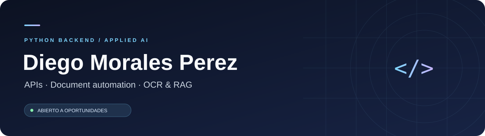

  <a href="https://www.linkedin.com/in/diegomoralesdev/"><b>LinkedIn</b></a> ·
  <a href="https://github.com/Devutec?tab=repositories"><b>Proyectos</b></a> ·
  <a href="https://github.com/kairos-Tech-UY"><b>Curupí / Kairos Tech</b></a>

## Software útil. IA aplicada. Integraciones que conectan.

Soy **Diego**, desarrollador backend y full stack con **más de cuatro años de experiencia**. Mi experiencia combina **React, Python, microservicios y bases de datos NoSQL**. También participo en **Curupí** con Kairos Tech y exploro la integración de **OCR y RAG** en aplicaciones documentales.

**Busco oportunidades en Backend Python y AI Engineering**, donde pueda aportar desarrollo de APIs, integración de servicios y seguir profundizando en IA aplicada.

<table>
<tr>
<td width="33%" valign="top"><h3>01 / Backend</h3>
Python · FastAPI · Pydantic

APIs, validación de datos y pruebas.
</td>
<td width="33%" valign="top"><h3>02 / IA aplicada</h3>
OCR · RAG · Documentos

Exploración de extracción y recuperación de información.
</td>
<td width="33%" valign="top"><h3>03 / Desarrollo</h3>
Docker · Linux · React Native

Entornos reproducibles y aplicaciones móviles con Expo.
</td>
</tr>
</table>

## Experiencia profesional destacada

### Dralmey · Full-stack Developer

Desarrollo de servicios backend, integraciones y funcionalidades de aplicaciones con **Python y React**.

- **Notificaciones:** integración de correo por SMTP y mensajería con Telegram.
- **AWS:** integración de servicios cloud y gestión de secretos con **AWS Secrets Manager**.
- **Microservicios:** comunicación entre servicios con **gRPC y Protocol Buffers (Protobuf)**.
- **Acceso y seguridad:** desarrollo de módulos de autorización.
- **Información de negocio:** desarrollo de reportes.
- **IA y herramientas:** trabajo con **MCP y agentes**.
- **Datos:** integración y optimización de bases de datos NoSQL, con foco en escalabilidad.

**Inicio de la experiencia:** julio de 2024. [Perfil laboral en GitHub](https://github.com/diegomoralesuru) · [LinkedIn](https://www.linkedin.com/in/diegomoralesdev/)

## Proyecto para explorar

### [Pokémon API →](https://github.com/Devutec/pokemon-api-fastapi)

**Python / FastAPI / Pydantic / pytest**

API CRUD desarrollada como proyecto académico de DevOps en **UTEC**. Incluye validación de datos, manejo de conflictos, pruebas y documentación interactiva con OpenAPI. Usa almacenamiento en memoria.

**Qué podés evaluar:** organización del backend, diseño de endpoints, validaciones y pruebas.

[Ver código y guía de ejecución](https://github.com/Devutec/pokemon-api-fastapi#readme)

## Mi actividad, en un solo lugar

Mi trabajo está distribuido entre tres cuentas. Cada perfil conserva su propio historial de contribuciones.

| Perfil | Dónde encontrarme |
| :--- | :--- |
| **Portfolio principal** | [Devutec](https://github.com/Devutec) |
| **Trabajo en Dralmey** | [diegomoralesuru](https://github.com/diegomoralesuru) |
| **Otra cuenta de desarrollo** | [diegomoralespdev](https://github.com/diegomoralespdev) |

## Laboratorio de IA

Exploro herramientas para transformar documentos en información utilizable. Estos enlaces apuntan a **forks de proyectos de terceros**; la autoría original corresponde a sus respectivos equipos.

| Foco | Repositorios de referencia |
| :--- | :--- |
| **OCR y extracción documental** | [PaddleOCR](https://github.com/Devutec/PaddleOCR) · [Tesseract](https://github.com/Devutec/tesseract) · [GLM-OCR](https://github.com/Devutec/GLM-OCR-AMALIOMETRIA) |
| **Recuperación y generación** | [Retrieval-Augmented-Generation](https://github.com/Devutec/Retrieval-Augmented-Generation) |

---

### ¿Buscás un perfil de Python e IA aplicada?

Me interesa conversar sobre oportunidades en **backend, automatización documental e integración de soluciones de IA**.

**[Conectemos en LinkedIn →](https://www.linkedin.com/in/diegomoralesdev/)**
